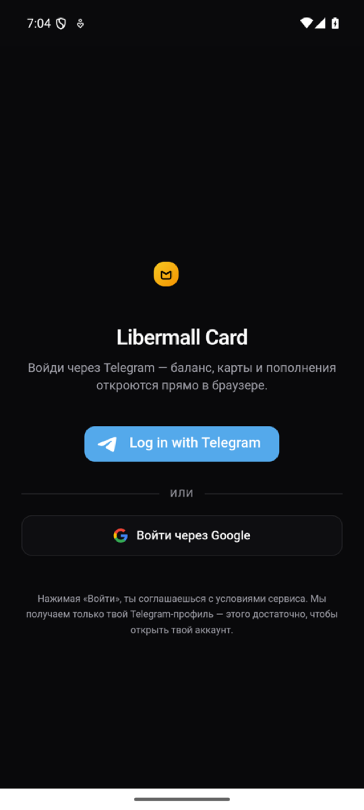
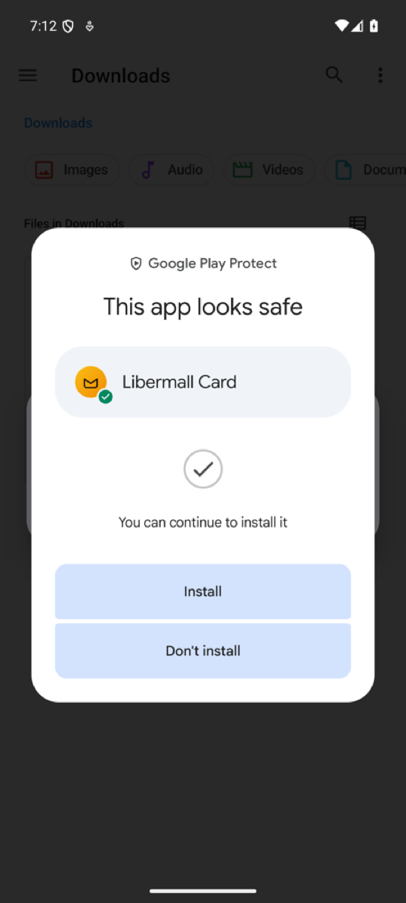

<div align="center">

# Libermall Card for Android

**The official Android app for [Libermall Card](https://card.libermall.com)** — crypto cards (Visa / Mastercard) with USDT top-ups, Apple Pay and Google Pay.

[](https://github.com/Libermall/libermall-card-android/releases/latest/download/libermall-card.apk)
[](https://github.com/Libermall/libermall-card-android/releases/latest)
[](#requirements)
[](https://card.libermall.com)

[**Download APK**](https://github.com/Libermall/libermall-card-android/releases/latest/download/libermall-card.apk) · [**Official download page**](https://card.libermall.com/android) · [**Web version**](https://card.libermall.com/web) · [**Telegram**](https://t.me/LibermallCardbot)

[Русская версия ↓](#русский)

</div>

---

## What is this?

The same Libermall Card account you use on the website and in Telegram — cards, top-ups, transaction history — as an app on your Android home screen. Sign in with Telegram or Google; the account is shared across all surfaces.

The app is a [Trusted Web Activity](https://developer.chrome.com/docs/android/trusted-web-activity): it runs `card.libermall.com` full-screen in Chrome, verified by [Digital Asset Links](https://card.libermall.com/.well-known/assetlinks.json). That means:

- **Always up to date** — new features arrive with the website, no need to reinstall.
- **Nothing extra on the device** — sign-in, sessions and payments work exactly as on the web; the app stores no keys or card data of its own.

<p align="center">
  
  &nbsp;&nbsp;
  
</p>

## Install

1. Download [`libermall-card.apk`](https://github.com/Libermall/libermall-card-android/releases/latest/download/libermall-card.apk).
2. Open the file. Android will ask to allow installs from this source — allow it and go back.
3. Google Play Protect may offer to scan the app — tap **Scan app**, then **Install**.
4. Open **Libermall Card** and sign in.

## Verify the file

Only download the app from this repository's [Releases](https://github.com/Libermall/libermall-card-android/releases) or from [card.libermall.com/android](https://card.libermall.com/android). Libermall and its support never send APK files in chats.

Each release lists the SHA-256 checksum of the APK (also in `SHA256SUMS.txt`). Check it with:

```bash
sha256sum libermall-card.apk
```

The signing certificate fingerprint (SHA-256) must be:

```
F1:7E:28:38:A6:E8:7E:40:A5:81:FB:7D:A6:48:71:7C:91:BB:D3:8A:5F:E0:DF:BF:8A:2F:6F:4E:7A:23:5C:1D
```

Check it with `apksigner verify --print-certs libermall-card.apk`. It is the same fingerprint published in [assetlinks.json](https://card.libermall.com/.well-known/assetlinks.json).

## Requirements

- Android 5.0 or newer
- Google Chrome (installed on most phones). Without it the app opens in your default browser.

## iPhone

There is no iOS app yet. Open the [web version](https://card.libermall.com/web) in Safari and choose **Share → Add to Home Screen**, or use [@LibermallCardbot](https://t.me/LibermallCardbot) in Telegram.

## Support

- Telegram: [@YouLibermallbot](https://t.me/YouLibermallbot)
- Security issues: see the [organisation security policy](https://github.com/Libermall/.github/blob/main/SECURITY.md)

---

<a id="русский"></a>

## Русский

**Официальное приложение [Libermall Card](https://card.libermall.com) для Android** — тот же кабинет, что на сайте и в Telegram: карты, пополнение, история операций. Вход через Telegram или Google, аккаунт общий.

**[Скачать APK](https://github.com/Libermall/libermall-card-android/releases/latest/download/libermall-card.apk)** · [страница загрузки на сайте](https://card.libermall.com/android)

### Как установить

1. Скачайте `libermall-card.apk`. Chrome может предупредить, что файл «может быть опасен», — так он пишет про любое приложение не из Google Play. Нажмите «Всё равно скачать».
2. Откройте файл. Android попросит разрешить установку из этого источника — включите переключатель и вернитесь назад.
3. Google Play Защита предложит проверить приложение — нажмите «Проверить», затем «Установить».
4. Откройте Libermall Card и войдите.

Обновлять приложение вручную не нужно: всё новое появляется в нём само, как на сайте.

### Безопасность

Скачивайте приложение только отсюда или с [card.libermall.com/android](https://card.libermall.com/android). Ни мы, ни поддержка не присылаем APK в чатах — такой файл может быть подделкой. Контрольная сумма SHA-256 указана в каждом релизе, отпечаток сертификата подписи — выше.

### iPhone

Приложения для iPhone пока нет: откройте [веб-версию](https://card.libermall.com/web) в Safari и добавьте её на экран «Домой».

### Поддержка

Telegram [@YouLibermallbot](https://t.me/YouLibermallbot)

---

<sub>© Libermall LLC. All rights reserved. The APK is distributed free of charge for personal use; the source of the Libermall Card service is not part of this repository.</sub>
